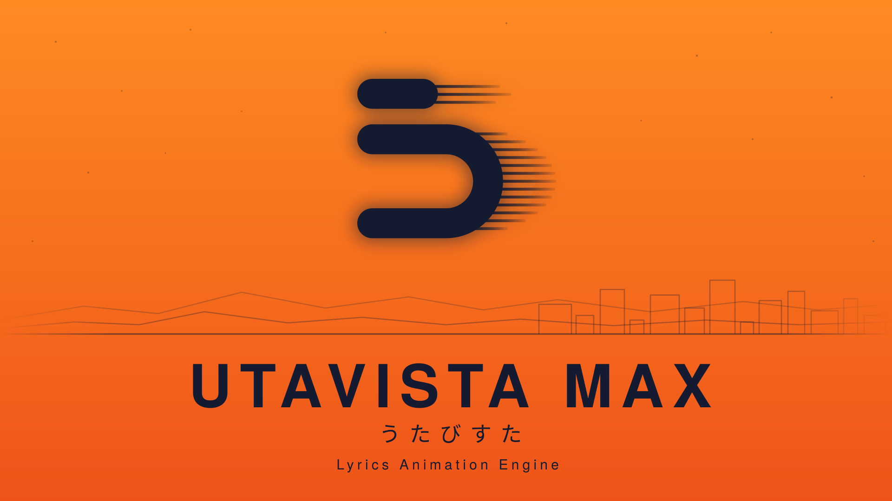

  

# UTAVISTA

UTAVISTA MAX（うたびすた MAX）は、歌詞アニメーションと映像演出を手がける macOS 向けの制作アプリです。

Claude Code との自然言語による対話を通じて、場面の構成、文字の動き、画像の配置、エフェクトを曲に合わせて作り込めます。用意した画像の読み込みに加え、接続した外部サービスでの画像生成にも対応。プレビューで確かめながら調整し、映像作品として書き出せます。

このリポジトリは **ビルド済みアプリの配布用** です。ソースコードは含まれていません。
v1（GPLv3）は [sousakujikken/utavista](https://github.com/sousakujikken/utavista) にあり、本リポジトリの v2 とはライセンスが異なります。

## ダウンロード

最新の MAX は [UTAVISTA MAX 2.1.13（Pre-release）](https://github.com/sousakujikken/utavista-app/releases/tag/v2.1.13) から `.dmg` を取得してください。
MAX は **2.1 系**、従来版は **2.0 系**として区別します。過去の配布物は [Releases](https://github.com/sousakujikken/utavista-app/releases) にあります。

> 現在は **ベータ版** です。仕様や操作方法は予告なく変わることがあります。重要なプロジェクトは定期的にバックアップしてください。

## 動作環境

| 項目 | 要件 |
|---|---|
| OS | macOS 13 Ventura 以降 |
| CPU | Apple Silicon（arm64） |
| GPU | WebGPU が利用できること（Apple Silicon 搭載 Mac は対応） |

Intel Mac 向けビルドは現時点では提供していません。任意の UTALIGN 解析機能は macOS 14 以降が必要です。

## インストール

1. MAX 2.1.13 の Release から `UTAVISTA.MAX-2.1.13-arm64.dmg` をダウンロードします。
2. dmg を開き、`UTAVISTA MAX.app` を `アプリケーション` フォルダにドラッグします。
3. 初回起動時に macOS の確認ダイアログが表示されたら「開く」を選びます。

アプリは Apple Developer ID で署名・公証されています。既存の MAX を更新する場合は、作品を保存してアプリを終了してから入れ替えてください。本体の更新は手動です。

## 主な機能

- 歌詞トラック、タイトル、フィルター、シェーダー、背景動画の 5 種類のトラックを重ねて構成
- テンプレートによる歌詞アニメーション（単語単位のスライド、黒帯スワイプ、パーティクルなど）
- WGSL シェーダーによるエフェクト
- H.264 / HEVC での動画書き出し
- 任意機能: ボーカル音声からの歌詞タイミング自動解析（[utalign](https://github.com/sousakujikken/utalign)、アプリ内からインストール可能）
- 任意機能: Claude Code / Codex CLI を使ったテンプレート生成支援（各 CLI と契約は利用者側で用意）

## 不具合報告・質問

[Issues](https://github.com/sousakujikken/utavista-app/issues) で受け付けています。
不具合の場合は、macOS のバージョン、アプリのバージョン、再現手順を添えてください。

## ライセンスとプライバシー

MAX 2.1 系には、[MAX Release の Assets](https://github.com/sousakujikken/utavista-app/releases/tag/v2.1.13) にある `LICENSE`・`PRIVACY.md`・`THIRD_PARTY_NOTICES.md` を参照してください。署名済み MAX アプリ内の文書と同一です。対応 OSS ソースと FFmpeg 差し替え手順も同じ Release にあります。

以下は従来版（2.0 系）の文書です。

- アプリの利用条件: [LICENSE](LICENSE)
- プライバシー通知: [PRIVACY.md](PRIVACY.md)
- 同梱する第三者コンポーネント: [THIRD_PARTY_NOTICES.md](THIRD_PARTY_NOTICES.md)

ビルド済みアプリは無償で利用できます。ソースコードは別途の利用許諾に基づいて提供されるもので、本リポジトリの対象外です。
